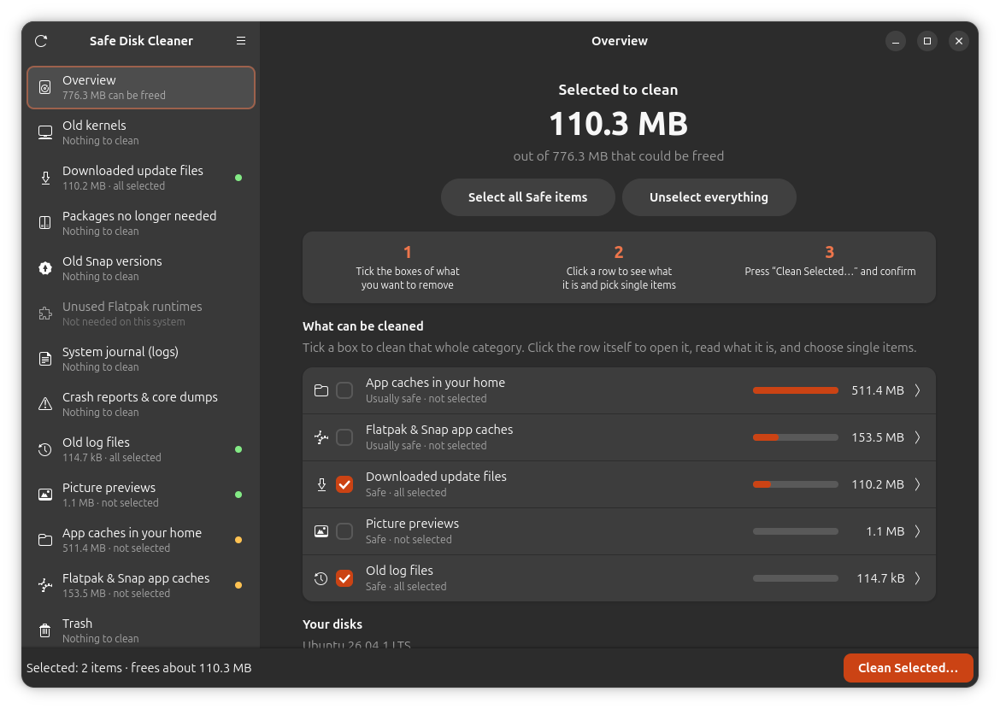

<div align="center">


# Safe Disk Cleaner

**See where your disk space went — and understand what is safe to delete.**

[](https://github.com/cyb3rl00m/safe-disk-cleaner/releases/latest)
[](LICENSE)


[](#credits)

[Install](#install) · [What it cleans](#what-it-cleans) · [How it keeps your system safe](#how-it-keeps-your-system-safe) · [FAQ](#faq) · [Credits](#credits) · [Contributing](CONTRIBUTING.md)

<br>



</div>

<br>

Linux quietly keeps gigabytes you'll never need: old kernels, downloaded update files, old Snap
versions, Flatpak runtimes nothing uses anymore, years of picture previews for files you deleted
long ago. Most cleaners show you a wall of checkboxes and hope you know what they mean.

**Safe Disk Cleaner explains every single item** — what it is, why it grew, whether deleting it is
safe, and exactly which command will run — and then lets *you* decide.

## Highlights

- 🧭 **Explains everything in plain language.** Every category answers four questions: *What is it?
  Why does it get so big? Is it safe to delete? What will this app do?*
- 🛡️ **Safe by design.** Only items marked *Safe* are pre-selected. The kernel you're running and a
  fallback kernel are always kept. Nothing is deleted until you confirm.
- 🔍 **Smarter, not just wider.** It reads every picture preview and removes only those whose file no
  longer exists. Previews of USB drives that aren't plugged in are kept.
- 📦 **Made for modern Linux.** Old Snap revisions and unused Flatpak runtimes — often several GB on
  Ubuntu — are first-class categories.
- 🔒 **Locks apps that are running.** Firefox's cache can't be deleted while Firefox is open.
- 📏 **Stops the problem from coming back.** One click caps the journal size for good, or sets how
  many Snap versions are kept.
- 📊 **Shows real results.** After cleaning it reports how much free space your disks actually gained.
- 👀 **Nothing hidden.** "Show the exact commands" reveals every command before it runs.

## What it cleans

| | Category | What it is | Label |
|:-:|---|---|---|
| 🐧 | **Old kernels** | Previous Linux kernels left behind by updates | Safe |
| ⬇️ | **Downloaded update files** | Package files APT / DNF / pacman / zypper kept after installing | Safe |
| 📦 | **Packages no longer needed** | Dependencies nothing uses anymore | Usually safe |
| 🔄 | **Old Snap versions** | Disabled revisions kept only for `snap revert` | Safe |
| 🧩 | **Unused Flatpak runtimes** | Runtimes no installed app needs | Safe |
| 📜 | **System journal** | Old entries of the system log — shrink it and cap it permanently | Safe |
| ⚠️ | **Crash reports & core dumps** | Memory snapshots of crashed programs | Safe |
| 🗂️ | **Old log files** | Rotated copies like `syslog.1` and `kern.log.2.gz` | Safe |
| 🖼️ | **Picture previews** | Thumbnails — especially of files that no longer exist | Safe |
| 📁 | **App caches in your home** | Every folder in `~/.cache`, each explained on its own | Per folder |
| 📱 | **Flatpak & Snap app caches** | Caches of sandboxed apps | Usually safe |
| 🗑️ | **Trash** | Every item with its original location and deletion date | Review first |

**What the labels mean**

- **Safe** — nothing you need is lost; it is recreated or re-downloaded if it's ever needed again.
- **Usually safe** — nothing personal is lost, but something is slower or re-downloaded once.
- **Review first** — could contain something you still want. Look through the list first.

## Install

### Ubuntu, Debian, Linux Mint, Pop!_OS — `.deb` package (recommended)

Download and install version 1.0.1:

```bash
wget https://github.com/cyb3rl00m/safe-disk-cleaner/releases/download/v1.0.1/safe-disk-cleaner_1.0.1_all.deb
sudo apt install ./safe-disk-cleaner_1.0.1_all.deb
```

Or download **`safe-disk-cleaner_1.0.1_all.deb`** by hand from the
[release page](https://github.com/cyb3rl00m/safe-disk-cleaner/releases/tag/v1.0.1), open a terminal in
the folder where you saved it (usually `cd ~/Downloads`), and run the second command.

Then open **Safe Disk Cleaner** from your app menu. APT installs everything it needs (GTK 4,
libadwaita, Python bindings and pkexec) automatically.

**Updating:** download the newest `.deb` from the
[releases page](https://github.com/cyb3rl00m/safe-disk-cleaner/releases) and install it the same way —
it replaces the old version.

### Fedora, Arch, openSUSE and others — from source

```bash
git clone https://github.com/cyb3rl00m/safe-disk-cleaner.git
cd safe-disk-cleaner
sudo bash install.sh
```

`install.sh` installs the dependencies with your package manager (APT, DNF, pacman or zypper) and
copies the app into `/usr/local` — the place for software that doesn't come from your package manager.
(Want it somewhere else? `sudo PREFIX=/opt/safe-disk-cleaner bash install.sh`)
On Arch it also installs `pacman-contrib`, which provides `paccache` for safely cleaning the package
cache while keeping the two newest versions of each package for downgrades.

### Try it without installing

```bash
git clone https://github.com/cyb3rl00m/safe-disk-cleaner.git
cd safe-disk-cleaner
python3 safe-disk-cleaner            # open the app
python3 safe-disk-cleaner --report   # or: print a read-only report in the terminal
```

### Uninstall

```bash
sudo apt remove safe-disk-cleaner     # if you installed the .deb
sudo bash uninstall.sh                # if you used install.sh
```

## How to use it

1. **Tick** what you want to remove — a whole category on the Overview, or single items inside it.
2. **Click a row** to read what it is and why it's safe.
3. **Press “Clean Selected…”**, read the summary (and the exact commands, if you like), and confirm.

You'll be asked for your password once if anything system-wide is selected.

## How it keeps your system safe

All system-level work goes through a small helper started with `pkexec`. The helper **does not
trust the app** — it re-checks everything against the system's current state before acting:

| Rule | Why it matters |
|---|---|
| The running kernel, the newest kernel and any kernel on hold are never removed; at least two always stay | You can always boot |
| Packages are removed only if APT's dry run removes **nothing** beyond your selection | No surprise removals |
| Orphaned packages are *removed*, not purged | Config files you edited in `/etc` are kept |
| Snap revisions are removed only if snapd still reports them as disabled | The version you use is never touched |
| Flatpak runtimes are removed only if Flatpak itself — checked as *you* — reports them unused | Your apps keep their runtimes |
| Files are deleted only inside `/var/crash`, `/var/lib/systemd/coredump` and `/var/log`, walked with `O_NOFOLLOW` | Symlinks can't redirect a delete |
| Log files written in the last hour are never deleted | Logs in use stay intact |
| Every value (journal sizes, package names, refs…) is checked against a whitelist | Garbage input is refused |

In your home folder, deletions stay inside the folder each item belongs to and never follow symlinks.

The test suite includes **attack tests** that fuzz the root helper with thousands of hostile requests
(`/etc/passwd`, `../` tricks, symlinks, fake package names) and check that nothing outside the
whitelist is ever deleted or run.

## Compared to BleachBit

[BleachBit](https://www.bleachbit.org/) is a mature tool with cleaners for a huge number of
applications, and it runs on Windows too. Safe Disk Cleaner focuses on something else: the big
system-level space hogs on a modern Ubuntu/systemd desktop, and on *explaining* them.

| | Safe Disk Cleaner | BleachBit |
|---|:-:|:-:|
| Explains each category: what, why, is it safe, what runs | ✅ | Short descriptions |
| Old kernels with a keep-running-plus-fallback rule | ✅ | Via APT autoremove |
| Removes old Snap revisions and unused Flatpak runtimes | ✅ | Cleans app data of some Snap/Flatpak apps |
| Removes only previews of files that no longer exist | ✅ | Deletes all previews |
| Caps the journal size permanently | ✅ | — |
| Locks caches of running apps | ✅ | Warns for some apps |
| Cleans browser history, cookies and privacy traces | — | ✅ |
| Windows support | — | ✅ |

<sub>Based on BleachBit's documented cleaners at the time of writing. Spotted something outdated?
Please open an issue — a fair comparison matters.</sub>

## Supported systems

Built for **Ubuntu 26.04 LTS**. Works on systemd-based distributions with GTK 4 and libadwaita 1.4
or newer: Ubuntu 24.04+, Debian 13, Linux Mint, Pop!_OS, Fedora, Arch, openSUSE Tumbleweed and more.

Categories that don't apply to your system — for example *Old kernels* on Fedora, which already keeps
only three — are shown as *Not needed on this system*.

## FAQ

<details>
<summary><b>Can it delete my personal files?</b></summary>

No. It never touches your documents, photos, music, downloads or projects. The only things it removes
from your home folder are caches, picture previews and — only if you tick them — items already in your
Trash.
</details>

<details>
<summary><b>Why does it ask for my password?</b></summary>

Kernels, package caches, Snap versions and system logs belong to the system. Removing them needs
administrator rights. The app asks once per clean, through the normal system password prompt.
</details>

<details>
<summary><b>Does it run in the background or clean automatically?</b></summary>

No. It does nothing until you open it, and deletes nothing until you press *Clean Selected…* and
confirm.
</details>

<details>
<summary><b>I'm troubleshooting a crash. What should I keep?</b></summary>

Leave *System journal* and *Crash reports & core dumps* unticked until the problem is solved — that's
where the evidence is.
</details>

<details>
<summary><b>A folder in ~/.cache says it's unknown. Is it safe?</b></summary>

Unknown folders are marked *Usually safe* and are never pre-selected. If you know what one is,
[tell us](../../issues/new?template=cache_folder.yml) and it will get a proper explanation.
</details>

## Credits

Safe Disk Cleaner is a collaboration between a human developer and an AI assistant.

| | |
|---|---|
| **[cyb3rl00m](https://github.com/cyb3rl00m)** — creator & maintainer | Came up with the idea and the goal: a cleaner that *explains* instead of just deleting. Decides what the app does and how it should look and feel, tests every version on real hardware, finds and reports what's broken or confusing, pushed for the safety audit, handles packaging, releases and the community, and keeps the project going. |
| **[Claude](https://claude.ai)** by Anthropic — AI pair programmer | Wrote most of the code, the root helper and its safety checks, the test suite and drafts of the documentation, following cyb3rl00m's direction and feedback. |

Every version is tested by cyb3rl00m on his own Ubuntu PC before it is released. Being upfront about
how the app is made matters to us — if you have questions about the code, open an issue.

## Contributing

Bug reports, ideas and pull requests are very welcome — see [CONTRIBUTING.md](CONTRIBUTING.md).
The easiest way to help is to [explain a cache folder](../../issues/new?template=cache_folder.yml)
the app doesn't know yet. Found a security problem? Please see [SECURITY.md](SECURITY.md).

## More apps by cyb3rl00m

- [**Crash Inspector**](https://github.com/cyb3rl00m/crash-inspector) — every crash and error on your
  system in one window
- [**Uninstaller**](https://github.com/cyb3rl00m/uninstaller) — completely remove APT, Snap and Flatpak
  apps

## License

[MIT](LICENSE) © 2026 cyb3rl00m
